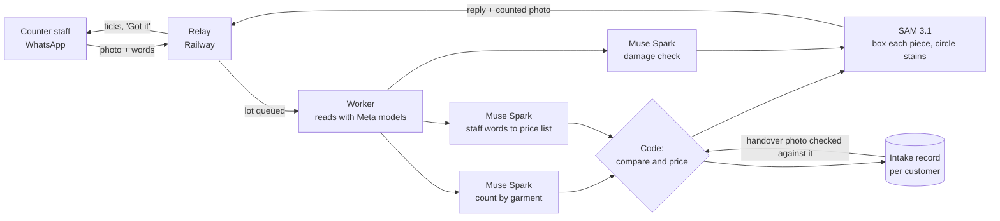

# Paizah Counter

**A laundry counter on WhatsApp, checked by Meta's models.**

Laundry counters in India run on desktop or mobile billing software: staff count each customer's lot by hand and key it in. At **Prezr**, a laundry in Thiruvananthapuram, the counter moved onto WhatsApp: staff photograph the lot and say what is in it ("3 shirts, 1 pant, steam press, customer 98470 00000"). Paizah Counter turns that into a product any laundry can adopt, with the checks a counter needs.

It reads the photo and the words separately with **Muse Spark** and **SAM 3.1**, compares them garment by garment, prices the lot from the laundry's own price list, records stains and tears on the floor before washing, and later checks the delivery photo against what came in. When the two readings agree, the quote is ready to send. When they disagree, staff are asked before anything reaches the customer.

Tested against **111 real quotes** from Prezr's counter.

Entry for the Meta Global AI Developer Hackathon, startup track, theme **Build for Your World**.

---

## What it does

Staff send a photo of the lot to the counter's WhatsApp number with the customer's number and the items as the caption. Within about 10 seconds they get back:

**1. The count, checked against their words, and priced**

```
Customer 9847000000
Check before this goes to the customer.
You said 3 pieces, the photo shows 4. Which pieces are missing from your message?
- shirt: you said 2, photo shows 3
Draft so far:
2 x Prezr_SP_Shirt @ Rs 20 = Rs 40
1 x Prezr_SP_Trouser/Pant @ Rs 25 = Rs 25
Total Rs 65
```

**2. Damage recorded on the floor, before washing** (floor staff send the photo at inspection to the same number)

```
Noted before washing (please check, and tell the customer):
- grey striped shirt: stain, large dark area across centre back
Folded pieces were checked on the side that shows.
```

**3. A counted photo**: every piece boxed and numbered by SAM 3.1, stains circled in red. It goes to the customer as the record of what they handed in.

**4. At handover**, a photo captioned `handover 98470 00000` is counted and compared with what was billed at intake:

```
Customer 9000000001: 7 in on 02 Nov 2026, 10:03, 7 going out. All there.
```

When something is short it says so before the bag leaves ("the photo shows 6. Check before the bag leaves: missing 1 t-shirt"), and any damage recorded at intake is listed again.

---

## Why it is more than an image analyser

A photo reading alone gets the count exactly right about 83 to 85% of the time. Staff typing alone is right about 81%. Neither is good enough to send to a customer. The product is the **check between them**:

- **Two independent readings.** Muse Spark counts the photo by garment. Muse Spark separately reads the staff's words against the laundry's price list. Neither sees the other's answer, except that "top" and "bottom" take their garment from the photo.
- **Code compares and prices.** A model never writes a price and never settles a disagreement. Disagreements go back to staff as a question.
- **The picture agrees with the quote.** SAM 3.1 boxes each piece by garment name; the counted photo never shows more boxes than the reading counted.
- **The record carries through.** What was billed at intake is what the handover photo is checked against, and damage found at intake is repeated at handover.

---

## Results on real counter data

Scored on **111 real Prezr counter quotes** (23 Sep to 29 Oct 2026, 121 photos) against what was **finally invoiced**. These are customers' clothes, so the photos are not in this repository.

| Measure | Result |
|---|---|
| Photo count exactly right (Muse Spark) | **84.7%** (82.9% with the current prompt, which adds a bedsheet rule) |
| Photo count within one piece | **95.5%** (both prompts) |
| Same, SAM 3.1 counting alone | 39.6% exact, 73.9% within one |
| Staff words and photo **agree** | 81 of 111 quotes; **79 of those right (97.5%)** |
| Staff words and photo **disagree** | 30 quotes, sent back to staff |
| Quotes where staff's count was wrong, caught by the check | **19 of 21** |
| Median time per photo reading | 4.7 s |
| Model cost per quote (count, words, damage, boxes) | about 3 US cents (about Rs 2.50) |

The agree and disagree rows use the first prompt's photo readings and the lines the live assistant first read from staff's messages.

What the numbers mean: about three in four lots go out without a second look and are right 97.5% of the time; nearly every staff counting error is caught before the customer sees it. SAM is poor at counting folded stacks, so it boxes and marks; Muse Spark counts.

Damage check, on public photos: a large stain and a faint sweat stain both found (confidence 0.95); a clean folded stack gave no false alarm, and a printed logo was not called damage.

---

## How it is built



| File | What it does |
|---|---|
| `src/quote.py` | Photo reading, damage reading, staff-words reading (Muse Spark); the garment-by-garment comparison and pricing |
| `src/receipt.py` | The counted photo (SAM 3.1): boxes per garment, capped at the reading's count; stains circled |
| `src/pipeline.py` | One lot end to end: intake, or handover against the intake record |
| `src/lots.py` | Intake record per customer; phone numbers taken exactly as written, never repaired |
| `src/server.py` | WhatsApp webhook, acknowledgement, queue; tells staff if no reader is online |
| `src/worker.py` | Collects queued lots, reads them, hands the reply back |
| `src/meta_api.py` | Meta Model API client: standard models only, nothing stored (`store: false`) |
| `eval/run_counts.py`, `eval/run_reconcile.py` | The scoring above |

**Why a relay and a worker.** Meta Model API answered `model_not_found` to calls from our cloud host (US and Singapore regions) while the same container worked from India. So the WhatsApp side runs in the cloud, and the reading runs where the API answers. The worker only makes outgoing calls, so it needs no public address.

---

## Built during the hackathon, and what already existed

Everything in this repository was written during the building period (first commit 30 Oct 2026; see the history).

| Built during the hackathon (this repo) | Already existed at Prezr (not in this repo, not submitted) |
|---|---|
| Photo count by garment (Muse Spark) | WhatsApp assistant that turns a staff voice note into a Zoho quote |
| Staff words checked against the photo, and priced | Zoho Books price list and quotes |
| Damage check before washing (Muse Spark) | Floor app: stages, inspection, packing, racks |
| Counted photo with boxes and stain marks (SAM 3.1) | Driver app and delivery |
| Handover count against the intake record | Office dashboard |
| WhatsApp counter service, relay and worker | |
| The scoring on 111 real quotes | |

The price list in `config/pricelist.json` is Prezr's, used with its permission.

---

## Running it

Needs a Meta Model API key and a WhatsApp Cloud API number.

```
python3 -m venv .venv && .venv/bin/pip install pillow==11.3.0
```

**Relay** (any host): `RELAY=1`, `WA_TOKEN`, `WA_PHONE_ID`, `VERIFY_TOKEN`, `ALLOWED_NUMBERS` (staff numbers, comma-separated), then `python src/server.py`. Point the WhatsApp webhook at `/webhook`.

**Worker** (where Meta Model API answers): `MODEL_API_KEY` in the environment or `.meta_key`, the same `VERIFY_TOKEN` in `.verify_token`, then `./run_worker.sh`.

Without a relay, run the server with `RELAY` unset and it reads the lots itself.

---

## Limits

- **Malayalam voice notes.** Muse Voice Transcribe does not list Malayalam, so staff type or caption for now. Typed Malayalam in English letters works ("moonu shirt, oru pant, iron cheyyanam").
- **Folded pieces** are checked for damage on the side that shows, and the reply says so.
- **The service** (garment, dry clean, press) comes from staff; a photo cannot show it.
- **Customer data.** Only standard-tier models, nothing stored by the API, and no customer photo in this repository.

Built by [Paizah](https://paizah.com), Thiruvananthapuram.
